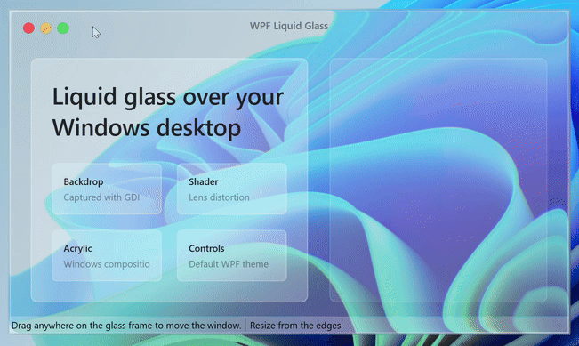
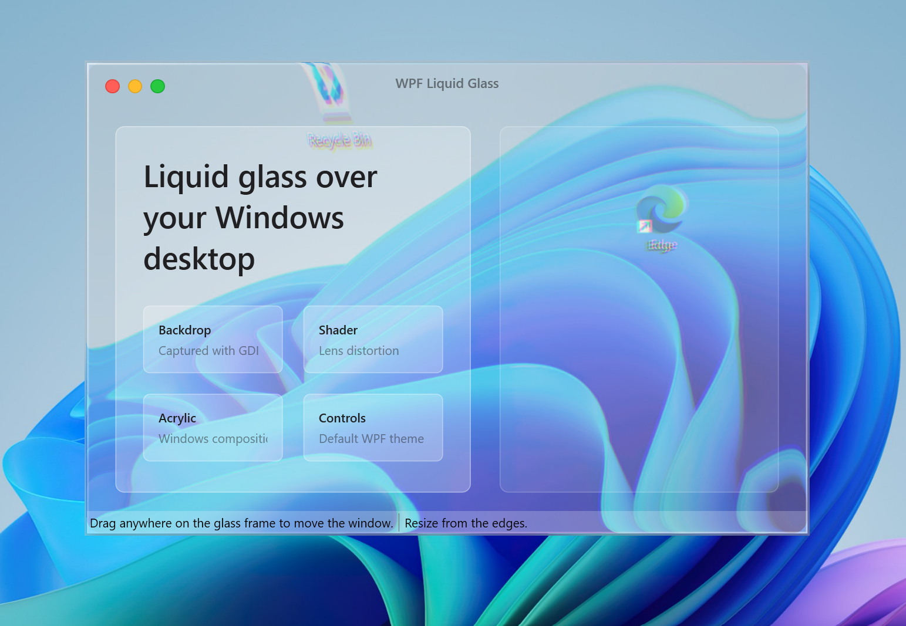

# wpf-liquid-glass-window

A small WPF sample that recreates an Apple Liquid Glass-inspired window surface on Windows.

<p align="center">
  
</p>

<p align="center">
  
</p>

[Watch the demo video](docs/Screen.mp4)

## Update: Feedback Hub suggestion

After sharing the prototype on X, Microsoft support suggested submitting the idea through Feedback Hub.

The goal is not to recreate old Aero Glass exactly, but to explore a modern native Windows material for stronger glass/refraction effects.

Feedback Hub title:

> "Bring back a modern Aero Glass / Liquid Glass material for Windows 11"

The demo consumes the private `Prism.Glass.Wpf` package. The package supplies the managed WPF host, native GPU renderer, desktop capture, and compiled `ClearGlass` shader without exposing the private SDK source.

The public repository keeps the borderless window template and demo content. The old GDI/`ShaderEffect` files remain temporarily for the visual-parity checkpoint, but the application no longer compiles or references them.

## How it works

`DemoApp/MainWindow.xaml` derives from `PrismGlassWindow` and selects the built-in `ClearGlass` preset. `DemoApp/Themes/LiquidGlassWindow.xaml` keeps the custom frame, caption buttons, resize targets, and content overlay while hosting the package-provided `WpfD3DImageHost`.

The style creates three visual layers:

1. `WpfD3DImageHost`, which presents the live native GPU surface.
2. A light translucent content layer that keeps the refracted desktop visible.
3. The existing title, caption buttons, border gradient, and resize hit targets.

The Prism Glass runtime captures and refracts the desktop continuously, updates while the window moves or resizes, and falls back to a readable tint if the GPU path is unavailable.

## Run

For private local development, point restore at the folder containing the package:

```powershell
if ([string]::IsNullOrWhiteSpace($env:PRISM_GLASS_NUGET_SOURCE)) {
    throw "Set PRISM_GLASS_NUGET_SOURCE to the folder containing the private Prism Glass packages."
}
dotnet restore .\DemoApp\DemoApp.csproj /p:RestoreAdditionalProjectSources="$env:PRISM_GLASS_NUGET_SOURCE"
dotnet build ".\02 WPF XAML Liquid Glass.slnx" --no-restore
```

`PRISM_GLASS_NUGET_SOURCE` is a developer-machine setting. No private feed path is committed to this repository. After publication, a normal NuGet.org restore replaces this local source step.

```powershell
dotnet run --project ".\DemoApp\DemoApp.csproj" --no-restore
```

## Notes for the article

This sample is not using any Apple private APIs. It is a WPF/Win32 approximation backed by the private Prism Glass native GPU pipeline and a compiled shader distributed through NuGet.

The shader approach was inspired by AmirHossein Aghajari's Medium article, "Liquid Glass: iOS Effect Explanation" published on November 24, 2025: https://medium.com/@aghajari/liquid-glass-ios-effect-explanation-dabadd6414ae

Apple and Liquid Glass are trademarks or design terms associated with Apple Inc. This repository is not affiliated with or endorsed by Apple.

## Structure

- `DemoApp/` - WPF demo application.
- `DemoApp/MainWindow.xaml` - `PrismGlassWindow` consumer configured with the built-in `ClearGlass` preset.
- `DemoApp/Themes/LiquidGlassWindow.xaml` - custom window chrome with the package-provided `WpfD3DImageHost`.
- `Prism.Glass.Wpf` - private package containing the managed adapters, native runtime, and compiled shaders.
- Legacy capture and `ShaderEffect` files remain only until visual parity is approved.
- `THIRD-PARTY-NOTICES.md` - attribution notes.

## License

MIT. See `LICENSE`.
